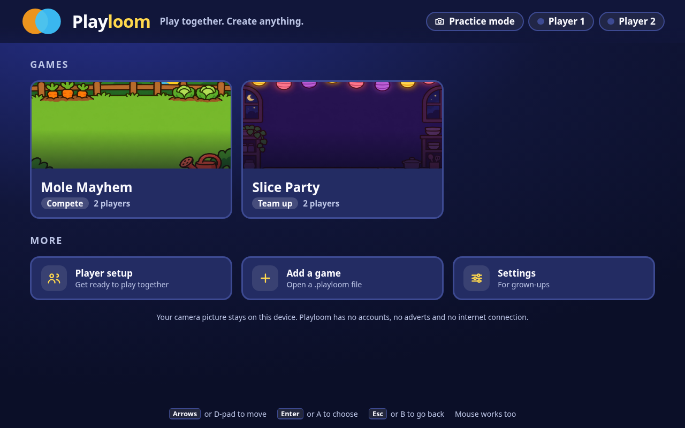

# Playloom

Playloom turns a computer and a webcam into a two-player motion game console. The camera
frames stay on the device. You can also practise with a mouse or touch input.

**[Open the browser demo](https://michaelaperry.github.io/Playloom/)** ·
[Desktop builds](#windows-and-linux-app) · [Project status](docs/status.md)



## What's available

The full-screen Console launches **Mole Mayhem** and **Slice Party**. Both games are data
files interpreted by the same rules runtime. The engine handles pose tracking, player identity
and gestures. A simulator lets developers exercise those rules with repeatable inputs.

**Status: Active.** The browser Console and Windows and Linux desktop builds are available.
Development has included webcam sessions with students. Most automated tests use simulated
players or synthetic video. Android support and the visual Studio are planned.

## Try it in a browser (no install)

**https://michaelaperry.github.io/Playloom/** — use Chrome or Edge. The browser asks for the camera;
pictures never leave your computer. No webcam? Choose **Practise without a camera**. The developer
playground is at [`/playground/`](https://michaelaperry.github.io/Playloom/playground/). Both are
republished on every push to `main`.

## Windows and Linux app

Open the repository's **Actions** tab, choose the latest **Desktop release** run and download
`playloom-windows` or `playloom-linux` from its artifacts (a GitHub sign-in is needed). To build a fresh
one, press **Run workflow**. See [platforms/desktop/README.md](platforms/desktop/README.md).

## Try it from source

Requirements: [Node.js](https://nodejs.org) 22 or newer and [pnpm](https://pnpm.io) 10.

```bash
pnpm install
```

```bash
pnpm fetch-models
```

```bash
pnpm dev
```

Open the address it prints. `pnpm fetch-models` downloads the pose model once (about 6 MB,
checksum-verified); after that everything runs without a network connection. `pnpm dev:playground`
starts the developer playground instead, with a skeleton view, event log and recording tools.

## Repository layout

```
packages/core        camera, tracking backends, player identity, gestures, calibration, performance
packages/simulator   simulated players, fault injection, pose recording and playback
packages/sdk         game format types and validator (MIT)
packages/runtime     interpreter for game definitions, canvas renderer, built-in sounds
games/               bundled games as data files
apps/console         the family-facing launcher
apps/playground      developer tool: motion test, event log, recording
platforms/desktop    Electron shell for Windows and Linux
docs/                architecture, status, API and guides
```

Studio and the Android shell arrive with their milestones; the planned
layout is in [docs/architecture/assessment.md](docs/architecture/assessment.md).

## Documentation

- [Project status and test evidence](docs/status.md)
- [Architecture assessment](docs/architecture/assessment.md) and [decisions](docs/architecture/decisions.md)
- [Motion API](docs/motion-api.md)
- [Console](docs/console.md)
- [Game format](docs/game-format.md) and [game packages](docs/game-packages.md)
- [Art prompts for the bundled games](docs/art-prompts.md)
- [Simulator](docs/simulator.md)
- [Building and testing](docs/building.md)
- [Performance profiles and the compatibility check](docs/performance.md)
- [Hardware compatibility](docs/hardware/compatibility.md)
- [Privacy](docs/privacy.md)

## Contributing

Contributions are welcome — see [CONTRIBUTING.md](CONTRIBUTING.md) and the
[Code of Conduct](CODE_OF_CONDUCT.md). Security issues: [SECURITY.md](SECURITY.md).

## License

Playloom is licensed under the [GNU General Public License v3.0 or later](LICENSE). Games and assets you
make with Playloom are yours, under whatever license you choose — see [LICENSING.md](LICENSING.md).
Third-party components are listed in [NOTICE.md](NOTICE.md).

Playloom is an independent project. It contains no code, assets or branding from any commercial motion
gaming product.
